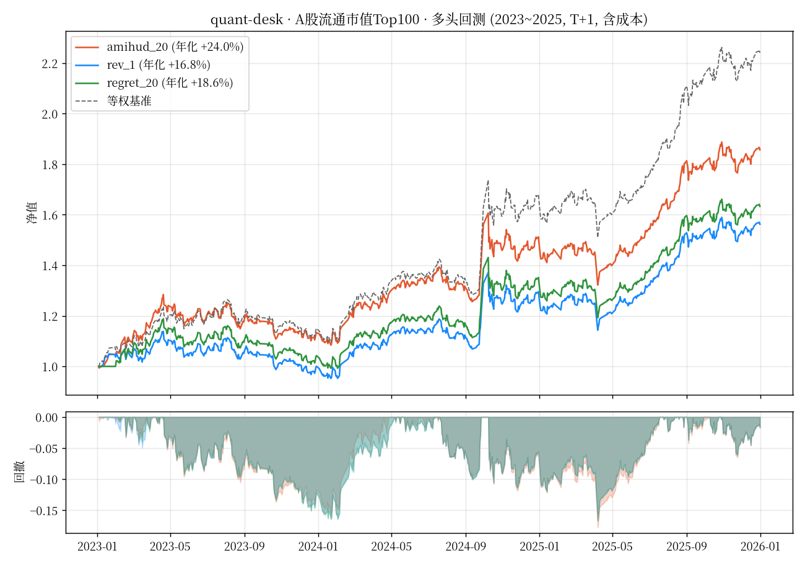

# quant-desk · 用 DeepSeek 搭建的量化交易平台

一个可运行的 A 股日频量化研究平台：**数据 → 因子（安全 DSL）→ 评测 → 回测 → LLM 因子工厂 → Web 界面**，全部本地、零付费行情（东方财富公开接口）+ 本机 Magpie 网关的 DeepSeek。

## 快速开始

```bash
cd quant-desk
python3 run.py                 # 启动 Web：http://127.0.0.1:8000/index.html
python3 -m pytest tests/ -q    # 46 个测试
```

```python
import qdesk
panel = qdesk.PanelStore(qdesk.CONFIG.data).panel()          # 自动抓取+缓存 A 股面板
r = qdesk.evaluate_factor("close / delay(close, 20) - 1", panel, horizon=20, sign=1)
print(r["ic"]["ic_mean"], r["ic"]["icir"])
```

## 架构

```
qdesk/
├── config.py        # 三段配置（数据 / LLM / 回测），环境变量覆盖
├── data/
│   ├── eastmoney.py # 东财公开接口：股票池（流通市值Top-N）+ 前复权日线
│   └── store.py     # MarketPanel（长表→宽表缓存、涨跌停/停牌/成交额掩码）、parquet 缓存
├── factors/
│   ├── dsl.py       # ★ 安全 DSL：AST 白名单编译，禁止 import/属性/下标/lambda
│   ├── library.py   # 16 个内置因子（动量/反转/波动/量价/流动性/Amihud…）
│   ├── engine.py    # 去极值→标准化→行业中性化
│   └── evaluate.py  # IC/ICIR/分层收益/衰减表
├── backtest/
│   ├── metrics.py   # 年化/夏普/回撤/Calmar/胜率/t 值/信息比率
│   └── engine.py    # 向量化回测：T+1、涨跌停不可买、双边成本+印花税
├── llm/
│   ├── client.py    # DeepSeek 客户端（官方 API / Magpie 网关自适应）
│   └── factor_factory.py  # 自然语言 → DSL 因子，编译校验+错误反馈重试+模板兜底
├── app.py           # FastAPI：/evaluate /backtest /llm/factor /factor-catalog /synthetic
└── tests/           # 46 个测试（DSL 安全注入、T+1 防泄露、成本、端到端）
```

## DSL 一览

**字段**：open/high/low/close/volume/amount/pct_chg/turnover/amplitude/vwap/ret/hl_range
**时序**：ts_mean/ts_std/ts_sum/ts_min/ts_max/ts_median/ts_skew/ts_delta/ts_pct/ts_zscore/ts_rank/ts_corr/ts_cov/decay_linear/delay（窗口须为正整数常量）
**截面**：cs_rank/cs_zscore/cs_demean/cs_scale/winsorize
**数学**：abs/log/sqrt/sign/exp/clip/safe_div/max/min/pow…

示例：`close / delay(close, 20) - 1`（动量）、`ts_max(close, 20) / close - 1`（回撤/遗憾）、`-ts_corr(close, volume, 20)`（量价背离）。

安全层用 `ast` 白名单编译（≤4000 字符、≤600 节点），任何越权语法直接拒绝——LLM 产物必须先过这一关才会被执行。

## 回测口径（写死在 engine.py 注释里）

因子 T 日收盘算出 → shift(1) 于 T+1 生效 → 执行日涨停/停牌/成交额<min_amount 的标的权重置 0 后归一 → 收盘对收盘。成本：佣金 2.5bp 双边 + 印花税 5bp 仅卖出 + 滑点 5bp 双边。已知偏差：收盘价近似次日成交价，会略微高估可交易性。

## 实测结果（A股流通市值 Top-100，2023-01 ~ 2025-12）

| 因子 | IC均值 | ICIR | IC_t | 组合年化 | 夏普 | 最大回撤 |
|---|---|---|---|---|---|---|
| amihud_20 非流动性 | +0.057 | 0.47 | 12.5 | **+24.0%** | 1.30 | -17.8% |
| regret_20 遗憾规避 | +0.029 | 0.12 | 3.1 | +18.6% | 1.07 | -16.7% |
| rev_1 日内反转 | +0.031 | 0.13 | 3.6 | +16.8% | 0.99 | -16.6% |
| mom_20 动量 | +0.025 | 0.10 | 2.7 | +16.4% | 0.94 | -18.9% |
| mom_60 动量(长) | -0.040 | -0.18 | -4.5 | (反向) | — | — |

等权基准年化 +32.3%（2024Q4-2025 大盘蓝筹牛市）；组合跑输基准但方向与 IC 一致（sign=+1 跑赢 sign=-1 约 6.6pp/年）。LLM 因子工厂实测 3/3 生成合法可编译 DSL（含 `ts_rank(close,20) - ts_rank(volume,20)` 量价背离）。



## DeepSeek 因子工厂

```python
from qdesk.llm.factor_factory import llm_build
r = llm_build("做一支5日超跌反弹因子，跌得越狠越买", available=False)
# → rev_5_deep, expr="close / delay(close, 5) - 1", sign=-1, source=llm
```

流程：意图 → prompt（DSL 约束+JSON schema）→ DeepSeek 生成 → DSL 编译校验 → 失败带错误反馈重试 → 仍失败回退内置模板。配置：`QD_LLM_BASE_URL`（默认 Magpie 网关 `127.0.0.1:3425/v1`）、`QD_LLM_MODEL`（默认 deepseek-v4.1-flash）、`QD_LLM_API_KEY`（sk- 开头走官方 API）。

## 免责

仅用于研究学习，不构成投资建议。行情数据来自东方财富公开接口，仅供个人研究。
